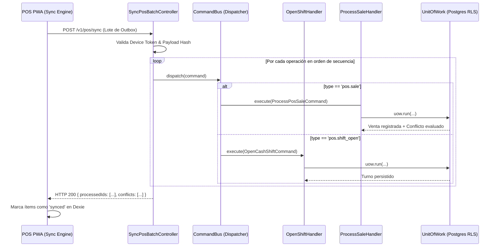

# Especificación Técnica de Arquitectura: CoreBiz POS (Offline-First)

**Versión:** 1.0.0  
**Estado:** Propuesta de Arquitectura (RFC)  
**Módulos Afectados:** `packages/domain`, `packages/contracts`, `packages/application`, `packages/db`, `apps/api`, `apps/pos`  
**Infraestructura Target:** Vercel (SPA estática PWA + NestJS Serverless) + Supabase (PostgreSQL 15+ con RLS)

---

## 1. Resumen Ejecutivo y Principios

El módulo **CoreBiz POS** dota a la plataforma de una terminal de punto de venta física con capacidad de operación ininterrumpida sin conexión a internet (**Offline-First**), diseñada para retail tradicional de alto tráfico de mostrador.

### 1.1. Principios Fundamentales de Diseño

1. **La realidad física del mostrador es soberana**: Una venta física es un hecho comercial consumado. Si el cliente tiene el producto en la mano y el dinero fue cobrado, el sistema **nunca rechaza ni descarta la venta** por falta de stock centralizado.
2. **Disponibilidad sobre consistencia inmediata (Teorema CAP)**: En el punto de venta prima la disponibilidad absoluta. Las inconsistencias de stock derivadas de ventas concurrentes o retrasos de remito se detectan, se aíslan y se gestionan como **Conflictos de Inventario auditables** en el ERP, sin parar la caja.
3. **Tesorería y Turnos Inquebrantables**: Ninguna venta o cobro flota en el vacío. Toda operación pertenece a una **Sesión de Caja (`CashShift`)**, abierta con fondo fijo inicial y cerrada con **arqueo ciego de efectivo**, registrando desvíos y sobrantes/faltantes.
4. **Trazabilidad de Tres Tiempos**: Cada transacción conserva:
   - `occurred_at`: Hora declarada por el reloj local de la terminal.
   - `received_at`: Momento de recepción del lote en la API.
   - `posted_at`: Momento de commit contable en la base de datos de Postgres.
5. **Cero Confianza en el Cliente (Zero-Trust Browser)**: La PWA corre en un entorno hostil (navegador). La API en NestJS valida permisos, firmas de terminal, cálculos aritméticos de impuestos y listas oficiales de precios en cada sincronización.

```mermaid
flowchart TD
    subgraph "Terminal Física (Cliente PWA / apps/pos)"
        Scanner["Lector de Barras / Cámara"] --> Cart["Carrito de Venta"]
        Cart --> DexieLocal[("Dexie.js / IndexedDB<br/>(Catalog + Balances)")]
        Cart --> OutboxLocal[("Cola Local: Outbox<br/>(Eventos pendientes)")]
        SyncManager["Sync Engine (Worker)"] -->|Lee pendientes| OutboxLocal
    end

    subgraph "Ingesta Backend (apps/api - NestJS Serverless)"
        SyncManager -->|POST /v1/pos/sync<br/>(Batch con operation_id + hash)| SyncController["Sync Batch Controller"]
        SyncController --> AuthGuard["Device Token & Tenant Guard (RLS)"]
        AuthGuard --> CommandBus["Command Bus (CodelyTV Pattern)"]

        CommandBus --> ShiftHandler["Open/CloseShift Handler"]
        CommandBus --> SaleHandler["ProcessPosSale Handler"]
        CommandBus --> CashHandler["CashMovement Handler"]
    end

    subgraph "Persistencia y Dominio (PostgreSQL Supabase con RLS)"
        SaleHandler --> UoW["Unit of Work (Transacción ACID)"]
        UoW --> SyncOps[("pos_sync_operations<br/>(Idempotencia)")]
        UoW --> SalesDB[("pos_sales & pos_sale_lines")]
        UoW --> ShiftsDB[("pos_cash_shifts")]
        UoW --> StockLedger[("stock_movements (Ledger Inmutable)")]
        ConflictDetector{"¿Saldo < 0 o Ítem no catalogado?"}
        ConflictDetector -->|Sí| ConflictsDB[("inventory_conflicts & conflict_movements")]
        ConflictDetector -->|No| Commit["Commit"]
        ConflictsDB --> NotificationOutbox[("notification_outbox")]
    end
```

---

## 2. Modelo de Identidad: Dispositivo vs. Caja vs. Cajero

Para evitar "hardware fingerprinting" frágil, se establece una separación estricta en 3 capas:

| Concepto                   | Entidad                    | Dónde se origina        | Responsabilidad                                                                        |
| -------------------------- | -------------------------- | ----------------------- | -------------------------------------------------------------------------------------- |
| **Instalación PWA**        | `installation_id` (UUIDv7) | IndexedDB del navegador | Identifica la instancia instalada en ese navegador específico.                         |
| **Terminal / Dispositivo** | `pos_devices`              | Backend (Enrolamiento)  | Dispositivo autorizado criptográficamente con token de terminal (`device_token_hash`). |
| **Caja Física**            | `pos_registers`            | ERP Administrativo      | Entidad contable física del local (ej. "Caja Mostrador 1", prefijo `POS-01`).          |
| **Turno de Caja**          | `pos_cash_shifts`          | PWA al abrir turno      | Sesión activa temporal con fondo fijo, cajero responsable y arqueo ciego.              |
| **Cajero / Operador**      | `users` + PIN              | ERP / Auth              | Usuario humano responsable de la caja con autenticación por PIN rápido local.          |

### Regla de Concurrencia de Cajas

- Una caja física (`pos_registers`) solo puede tener **un dispositivo activo asignado** y **un turno abierto (`pos_cash_shifts`) a la vez**.
- Un cajero no puede abrir sesión en una caja si el turno anterior no fue cerrado con su respectivo arqueo.

---

## 3. Modelo de Datos Backend (Prisma / PostgreSQL)

Adaptado estrictamente a las convenciones de CoreBiz: nombres en `snake_case`, claves `UUID`, importes monetarios en `BigInt` minor units (centavos), cantidades enteras o escaladas en `BigInt` y aislamiento obligatorio por `tenant_id` con RLS.

### 3.1. Dispositivos y Cajas

```prisma
model pos_registers {
  id               String   @id @default(dbgenerated("gen_random_uuid()")) @db.Uuid
  tenant_id        String   @db.Uuid
  name             String   @db.VarChar(100)
  code             String   @db.VarChar(20) // Ej. "POS-01"
  status           String   @default("active") @db.VarChar(30) // active, inactive
  created_at       DateTime @default(now()) @db.Timestamptz(6)
  updated_at       DateTime @default(now()) @db.Timestamptz(6)

  shifts           pos_cash_shifts[]
  assignments      pos_register_assignments[]
  sales            pos_sales[]

  @@unique([tenant_id, code])
  @@index([tenant_id])
}

model pos_devices {
  id                String    @id @default(dbgenerated("gen_random_uuid()")) @db.Uuid
  tenant_id         String    @db.Uuid
  installation_id   String    @db.Uuid
  name              String    @db.VarChar(100)
  platform          String?   @db.VarChar(50)
  browser           String?   @db.VarChar(50)
  status            String    @default("pending") @db.VarChar(30) // pending, active, revoked
  device_token_hash String?   @db.VarChar(128)
  registered_at     DateTime  @default(now()) @db.Timestamptz(6)
  last_seen_at      DateTime? @db.Timestamptz(6)

  assignments       pos_register_assignments[]
  sync_operations   pos_sync_operations[]
  shifts            pos_cash_shifts[]
  sales             pos_sales[]

  @@unique([tenant_id, installation_id])
  @@index([tenant_id])
}

model pos_register_assignments {
  id               String    @id @default(dbgenerated("gen_random_uuid()")) @db.Uuid
  tenant_id        String    @db.Uuid
  register_id      String    @db.Uuid
  device_id        String    @db.Uuid
  assigned_at      DateTime  @default(now()) @db.Timestamptz(6)
  revoked_at       DateTime? @db.Timestamptz(6)
  assigned_by      String    @db.Uuid

  register         pos_registers @relation(fields: [register_id], references: [id])
  device           pos_devices   @relation(fields: [device_id], references: [id])

  @@index([tenant_id, register_id, revoked_at])
}
```

### 3.2. Tesorería y Turnos (`pos_cash_shifts`)

```prisma
model pos_cash_shifts {
  id                   String    @id @default(dbgenerated("gen_random_uuid()")) @db.Uuid
  tenant_id            String    @db.Uuid
  register_id          String    @db.Uuid
  device_id            String    @db.Uuid
  opened_by_user_id    String    @db.Uuid
  opened_at            DateTime  @db.Timestamptz(6)
  initial_float_minor  BigInt    // Fondo inicial de cambio
  status               String    @default("open") @db.VarChar(30) // open, closed, audited
  closed_by_user_id    String?   @db.Uuid
  closed_at            DateTime? @db.Timestamptz(6)
  declared_cash_minor  BigInt?   // Arqueo ciego contado por el cajero
  system_cash_minor    BigInt?   // Calculado por el sistema al cierre
  cash_variance_minor  BigInt?   // Diferencia (declared - system)
  notes                String?   @db.Text
  created_at           DateTime  @default(now()) @db.Timestamptz(6)

  register             pos_registers        @relation(fields: [register_id], references: [id])
  device               pos_devices          @relation(fields: [device_id], references: [id])
  sales                pos_sales[]
  cash_movements       pos_cash_movements[]

  @@index([tenant_id, register_id, status])
}

model pos_cash_movements {
  id           String   @id @default(dbgenerated("gen_random_uuid()")) @db.Uuid
  tenant_id    String   @db.Uuid
  shift_id     String   @db.Uuid
  movement_type String  @db.VarChar(40) // cash_in (ingreso extra), cash_out (sangría/retiro)
  amount_minor BigInt
  reason       String   @db.VarChar(200)
  occurred_at  DateTime @db.Timestamptz(6)
  created_at   DateTime @default(now()) @db.Timestamptz(6)

  shift        pos_cash_shifts @relation(fields: [shift_id], references: [id])

  @@index([tenant_id, shift_id])
}
```

### 3.3. Ventas de Mostrador (`pos_sales`)

```prisma
model pos_sales {
  id               String   @id @default(dbgenerated("gen_random_uuid()")) @db.Uuid
  tenant_id        String   @db.Uuid
  register_id      String   @db.Uuid
  device_id        String   @db.Uuid
  shift_id         String   @db.Uuid
  cashier_user_id  String   @db.Uuid
  operation_id     String   @db.Uuid // UUID del outbox offline
  ticket_number    String   @db.VarChar(50) // Ej. "POS-01-000045"
  status           String   @default("completed") @db.VarChar(30) // completed, voided
  subtotal_minor   BigInt
  tax_minor        BigInt
  total_minor      BigInt
  payment_method   String   @db.VarChar(30) // cash, card, transfer, split
  occurred_at      DateTime @db.Timestamptz(6) // Reloj local
  received_at      DateTime @default(now()) @db.Timestamptz(6) // Ingesta API
  posted_at        DateTime @default(now()) @db.Timestamptz(6) // Commit DB

  register         pos_registers    @relation(fields: [register_id], references: [id])
  device           pos_devices      @relation(fields: [device_id], references: [id])
  shift            pos_cash_shifts  @relation(fields: [shift_id], references: [id])
  lines            pos_sale_lines[]

  @@unique([tenant_id, operation_id])
  @@index([tenant_id, register_id, occurred_at])
}

model pos_sale_lines {
  id                String   @id @default(dbgenerated("gen_random_uuid()")) @db.Uuid
  tenant_id         String   @db.Uuid
  sale_id           String   @db.Uuid
  product_id        String?  @db.Uuid // NULL si fue ítem de contingencia "Venta Varios"
  temporary_name    String?  @db.VarChar(200) // Descripción si no estaba catalogado
  barcode_scanned   String?  @db.VarChar(100) // Código de barra leído
  quantity          BigInt
  unit_price_minor  BigInt
  line_total_minor  BigInt
  created_at        DateTime @default(now()) @db.Timestamptz(6)

  sale              pos_sales @relation(fields: [sale_id], references: [id], onDelete: Cascade)

  @@index([tenant_id, sale_id])
}
```

### 3.4. Ingesta, Idempotencia y Conflictos

```prisma
model pos_sync_operations {
  id              String    @id @default(dbgenerated("gen_random_uuid()")) @db.Uuid
  tenant_id       String    @db.Uuid
  operation_id    String    @db.Uuid // Identificador emitido por la PWA
  device_id       String    @db.Uuid
  operation_type  String    @db.VarChar(100) // pos.sale, pos.shift_open, etc.
  sequence        BigInt
  payload_hash    String    @db.VarChar(128) // SHA-256
  status          String    @default("received") @db.VarChar(30) // received, processed, failed
  received_at     DateTime  @default(now()) @db.Timestamptz(6)
  processed_at    DateTime? @db.Timestamptz(6)
  error_message   String?   @db.Text

  device          pos_devices @relation(fields: [device_id], references: [id])

  @@unique([tenant_id, operation_id])
  @@unique([tenant_id, device_id, sequence])
  @@index([tenant_id, status])
}

model inventory_conflicts {
  id                 String    @id @default(dbgenerated("gen_random_uuid()")) @db.Uuid
  tenant_id          String    @db.Uuid
  product_id         String?   @db.Uuid
  conflict_type      String    @db.VarChar(50) // negative_stock, uncataloged_product
  status             String    @default("open") @db.VarChar(30) // open, investigating, resolved, dismissed
  detected_at        DateTime  @default(now()) @db.Timestamptz(6)
  stock_before       BigInt    @default(0)
  quantity_attempted BigInt    @default(0)
  stock_after        BigInt    @default(0)
  shortage_quantity  BigInt    @default(0)
  resolution_type    String?   @db.VarChar(50) // adjustment_in, catalog_created, etc.
  resolution_notes   String?   @db.Text
  resolved_by        String?   @db.Uuid
  resolved_at        DateTime? @db.Timestamptz(6)

  movements          inventory_conflict_movements[]

  @@index([tenant_id, status, product_id])
}

model inventory_conflict_movements {
  id                    String   @id @default(dbgenerated("gen_random_uuid()")) @db.Uuid
  tenant_id             String   @db.Uuid
  conflict_id           String   @db.Uuid
  stock_movement_id     String?  @db.Uuid
  sale_id               String?  @db.Uuid
  relation_type         String   @db.VarChar(30) // cause, context, resolution
  created_at            DateTime @default(now()) @db.Timestamptz(6)

  conflict              inventory_conflicts @relation(fields: [conflict_id], references: [id], onDelete: Cascade)

  @@index([tenant_id, conflict_id])
}

model notification_outbox {
  id             String    @id @default(dbgenerated("gen_random_uuid()")) @db.Uuid
  tenant_id      String    @db.Uuid
  event_type     String    @db.VarChar(100) // pos.conflict_detected, pos.shift_closed
  aggregate_id   String    @db.Uuid
  payload        Json
  status         String    @default("pending") @db.VarChar(30) // pending, sent, failed
  attempts       Int       @default(0)
  available_at   DateTime  @default(now()) @db.Timestamptz(6)
  sent_at        DateTime? @db.Timestamptz(6)
  created_at     DateTime  @default(now()) @db.Timestamptz(6)

  @@index([tenant_id, status, available_at])
}
```

---

## 4. Frontend: PWA con Dexie.js y Patrón Outbox

La aplicación `apps/pos` se estructura como una SPA React/Vite independiente en el monorepo, instalable como PWA.

### 4.1. Esquema Local en IndexedDB (`Dexie`)

```typescript
import Dexie, { type Table } from 'dexie';

export interface LocalProduct {
  id: string;
  sku: string;
  barcode: string | null;
  name: string;
  priceMinor: number;
  taxable: boolean;
  trackStock: boolean;
  quantityOnHand: number;
}

export interface LocalOutboxOperation {
  id: string; // UUIDv7
  type: 'shift.open' | 'sale.created' | 'cash.movement' | 'shift.close';
  sequence: number;
  payload: Record<string, unknown>;
  status: 'pending' | 'syncing' | 'synced' | 'failed';
  attempts: number;
  createdAt: number;
}

export interface LocalShift {
  id: string;
  registerId: string;
  cashierUserId: string;
  openedAt: string;
  initialFloatMinor: number;
  status: 'open' | 'closed';
}

export class PosDatabase extends Dexie {
  products!: Table<LocalProduct, string>;
  outbox!: Table<LocalOutboxOperation, string>;
  shifts!: Table<LocalShift, string>;

  constructor() {
    super('CoreBizPosDB');
    this.version(1).stores({
      products: 'id, sku, barcode, name',
      outbox: 'id, type, status, sequence, createdAt',
      shifts: 'id, status',
    });
  }
}

export const localDb = new PosDatabase();
```

### 4.2. Flujo Local de Venta (Latencia 0 ms)

Cuando el cajero presiona **"Cobrar"**:

1. Se genera un `operation_id = uuidv7()`.
2. Se incrementa la secuencia monotónica de la terminal (`localSequence++`).
3. En una sola transacción de Dexie:
   - Se reduce el stock local de los productos para refrescar la UI.
   - Se crea el ticket en la tabla local.
   - Se inserta en `outbox` con estado `pending`.
4. Se dispara la impresión del ticket térmico (`window.print()` o WebUSB/ESC-POS).
5. Se notifica al `SyncEngine` en segundo plano para intentar el push.

---

## 5. Backend: Arquitectura Hexagonal y Command Bus (CodelyTV)

Para erradicar condicionales y archivos sobredimensionados, la ingesta desacopla completamente el transporte HTTP de la ejecución de casos de uso.



### 5.1. Idempotencia y Manejo del Hash

Si el dispositivo reenvía una operación por micro-cortes de conexión:

1. La API consulta `pos_sync_operations` por `(tenant_id, operation_id)`.
2. Si existe y el `payload_hash` coincide: retorna `OK` de inmediato sin re-ejecutar el comando.
3. Si existe pero el hash difiere: aborta con `409 Conflict` (posible manipulación en cliente).

---

## 6. Escaneo de Códigos y Generación Estándar de SKUs

### 6.1. Doble Canal de Escaneo

1. **Pistola de Mostrador (PC / USB / Bluetooth)**:
   - Funciona mediante emulación de teclado (`HID Keyboard Wedge`).
   - Se implementa un hook global `useBarcodeScanner()` que escucha pulsaciones con intervalo menor a 30 ms terminadas en la tecla `Enter`.
2. **Cámara Móvil / Tablet**:
   - Se utiliza la API nativa del navegador `BarcodeDetector` (W3C standard), sin librerías de terceros pesadas.

### 6.2. Generación Estándar de Códigos Internos (EAN-13 GS1)

Si un producto no posee código de barra de fábrica, el sistema genera un código bajo el estándar de **circulación interna GS1 (Prefijos 20 a 29)**:

- **Estructura**: `20` + `8 dígitos de secuencia incremental` + `Dígito verificador Módulo 10`.
- Esto garantiza compatibilidad universal con cualquier lector óptico o balanza del mercado.

---

## 7. Manejo y Resolución de Conflictos en el ERP

Cuando una venta sincrónica produce saldo negativo o incluye un ítem no catalogado:

1. La venta se asienta íntegramente.
2. Se inserta un registro en `inventory_conflicts`.
3. El administrador accede a la ruta `/conflicts` en el ERP (`apps/web`):
   - **Conflicto de Stock Negativo**: Muestra la venta, las cajas involucradas y un botón _"Ajustar Inventario"_, que ejecuta [`makeAdjustStock`](file:///D:/Dev/CoreBiz/packages/application/src/use-cases/products/adjust-stock.ts) registrando la justificación.
   - **Conflicto de Producto no Catalogado**: Muestra el nombre provisorio y el precio cobrado en la caja, permitiendo con un clic:
     - _Dar de alta definitiva en el catálogo central_.
     - _Vincular a un producto existente_.

---

## 8. Hoja de Ruta de Implementación (Roadmap Vertical)

1. **Fase 1: Contratos y Esquema de Base de Datos**
   - Migración Prisma con las tablas `pos_*` e `inventory_conflicts`.
   - Esquemas Zod en `packages/contracts` para sincronización y turnos.
2. **Fase 2: Dominio y Casos de Uso (Hexagonal)**
   - Agregados `CashShift` y `PosSale` en `packages/domain`.
   - Casos de uso de apertura, cierre ciego, venta y conciliación en `packages/application`.
3. **Fase 3: Backend Ingesta y Command Bus (NestJS)**
   - Endpoints de autenticación de terminal, pull de catálogo delta y push de sync.
   - Implementación de Handlers desacoplados e idempotencia con hash.
4. **Fase 4: Frontend PWA (`apps/pos`)**
   - Setup de la app PWA con Vite, Dexie.js y Service Worker completo.
   - Pantalla de ingreso por PIN, mostrador de cobro rápido y outbox worker.
5. **Fase 5: UI de Resolución de Conflictos en el ERP (`apps/web`)**
   - Bandeja de gestión de incidencias de stock y catálogo provisorio.
